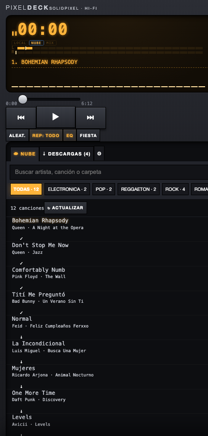

# Pixel Deck · musicUI

Clon visual de la UI **Pixel Deck** (reproductor móvil) construido con [FletBox](https://github.com/kuko53348/flet-box), usando la API de widgets de FletBox directamente (sin React/Vue/JSX).



## Qué incluye

- **Display estilo VFD**: reloj, estado, lámparas (LOCAL/NUBE/MIX), marquee del track, medidor de espectro y VU en `Canvas`.
- **Transporte**: play/pausa, anterior/siguiente, seek, aleatorio, repetir, EQ y modo FIESTA.
- **Audio real**: integrado con el widget `Audio` de FletBox (play/pause/seek/timeupdate/load/end). Usa pistas demo de SoundHelix para reproducción verificable.
- **Playlist**: pestañas Nube/Descargas, búsqueda, chips por carpeta, lista virtualizada.
- **Hoja SONIDO**: crossfade, modo fiesta, ecualizador de 10 bandas + PRE/MASTER, presets.

## Stack

- **FletBox** (widgets JS, runtime propio)
- JavaScript ESM
- CSS residual solo para keyframes, pseudo-elementos (`range`, scrollbar) y estados por clase (`:active`, `.on`, `.compact`, etc.); estilos base migrados a props planas de FletBox.

## Estructura

```text
src/
  screens/PlayerScreen.js   # Pantalla principal y lógica de reproducción
  components/Display.js     # Display VFD + Canvas (espectro/VU)
  components/SoundSheet.js  # Hoja SONIDO / EQ
  components/VirtualList.js # Lista de pistas
  theme.js                  # Tokens de color/fuente
  styles.css                # Keyframes, pseudo-elementos y reglas de estado
docs/
  screenshot.png
```

## Requisitos

- Node.js `>=20.9.0`
- Dependencias del proyecto (`npm install`)

## Ejecutar

```bash
npm install
npm run dev
```

El proyecto usa los scripts de FletBox definidos en `package.json` (`flet-box check-api --emit-api`, `flet-box unpack --all --md`, etc.).

## Verificación

```bash
./node_modules/.bin/tsc --noEmit -p jsconfig.json --pretty false
```

## Notas

- El audio de demo requiere interacción del usuario (clic en ▶) por políticas de autoplay del navegador.
- Las fuentes demo son MP3 públicos de SoundHelix; en producción deben reemplazarse por las fuentes reales del catálogo.
- `className` se mantiene como hook para estados/pseudo-selectores; las props visuales base se pasan como props planas FletBox.
